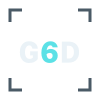

  

  <h1>Gelopard</h1>

  
Gelopard builds games and tools. The studio is run by one person.

  
<a href="https://gelopard.com">gelopard.com</a>

---

`SEC-01 / STUDIO`

Gelopard is the developer name across the App Store, Google Play, the studio
site, credits, and this organisation. Repositories here are private while
titles are in development.

| | |
|---|---|
| Entity | Hedvig Holding AB |
| Reg. no | `559346-1865` |
| VAT no | `SE559346186501` |
| Registered office | Solna, Sweden |
| Employees | `0` |

`SEC-02 / WORKS`

Small projects, all in alpha. They change without notice.

| Title | Status | Link |
|---|---|---|
| Wake Alone | Alpha | [wake.urdr.dev](https://wake.urdr.dev) |
| Dibs | Alpha | [dibs.urdr.dev](https://dibs.urdr.dev) |
| Skugga | Alpha | [skugga.urdr.dev](https://skugga.urdr.dev) |

---

  gelopard.com &middot; Stockholm

